# Exchange, OVH et assistant Mistral : décision technique

État des recherches et du code au **16 novembre 2026**. Cette note prépare l'environnement privé ; elle ne modifie ni le site public, ni une boîte mail, ni l'hébergement. Les recommandations ci-dessous sont des choix d'architecture, pas une certification ou une analyse juridique individualisée.

## Décisions proposées

- Conserver Exchange chez la collectivité ou son prestataire. Relier une boîte ou un périmètre dédié, avec des droits minimaux accordés par la DSI.
- Conserver l'interface et le domaine métier actuels. Réutiliser les connecteurs protocolaires libres plutôt que déployer un deuxième ERP complet.
- Choisir **Mistral Small 4, `mistral-small-2603`**, comme premier candidat pour le chatbot documentaire français. Comparer GLM 5.3 Flash avant toute décision de qualité définitive.
- Utiliser une API d'inférence régionale approuvée, sans historique hébergé chez le fournisseur, avec ZDR effectivement activé. Si les données doivent rester dans un périmètre qualifié, prévoir aussi l'inférence dans ce périmètre ; une API externe n'en fait pas automatiquement partie.
- Réserver le VPS OVH ordinaire au pilote selon l'analyse de risques. Pour l'objectif de forte assurance, étudier une offre qualifiée exacte et une exploitation avec sauvegarde indépendante, cloisonnement et reprise testée.
- Traiter les écarts P0 ci-dessous avant les courriels municipaux réels. Le raccordement réel n'a pas été testé dans cette recherche.

## Comment un mail hébergé ailleurs arrive dans Travaux

La boîte reste à son emplacement actuel. Le serveur de l'application récupère une copie autorisée : aucun changement de domaine de messagerie ou de MX n'est nécessaire pour cette lecture.

```mermaid
flowchart LR
    E[Exchange collectivité ou prestataire] -->|Accès de lecture autorisé et chiffré| C[Collecteur isolé]
    C --> S[Original du mail et pièces en quarantaine]
    S --> X[Extraction contrôlée]
    X --> R[Recherche parmi les chantiers autorisés]
    R --> I[Propositions IA avec sources]
    I --> H[Validation par un agent]
    H --> D[Dossier et actions confirmées]
```

Exemple : un mail « avenant école Keravel » arrive dans le dossier Exchange choisi. Travaux conserve l'original, identifie les références et propose un chantier avec la preuve. Si le chantier ou le responsable est ambigu, la proposition reste à vérifier. Le nom de l'expéditeur ne suffit pas à lui conférer des droits ; le texte du mail ne devient jamais une instruction système.

Le connecteur garde un curseur durable et des identifiants de source pour reprendre après une panne sans créer d'actions en double. Lire un message ne doit pas le marquer comme lu, le déplacer, le supprimer ou l'envoyer. Une disparition côté Exchange n'autorise pas à purger une archive publique.

### Deux cas Exchange à distinguer

| Hébergement confirmé par la DSI | Raccordement à retenir |
| --- | --- |
| Exchange Server chez la collectivité ou un prestataire | API/protocole et authentification effectivement autorisés. L'adaptateur EWS existant peut être évalué sur un compte pilote ; sa compatibilité avec la version, TLS et la politique d'authentification reste à prouver. Si Exchange est interne, VPN ou collecteur dans le réseau DSI avec relais authentifié à développer ; ne pas ouvrir un nouvel accès public à Exchange. |
| Exchange Online / Microsoft 365, y compris certains hébergements présentés comme « Exchange » | Microsoft Graph et OAuth. Le démarrage du retrait global d'EWS date d'octobre 2026 ; ne pas construire une nouvelle intégration Online sur EWS. Les exceptions de transition n'en font pas une cible durable. |

Le calendrier concerne **Exchange Online**, pas automatiquement Exchange Server. [Microsoft : retrait EWS et migration](https://learn.microsoft.com/en-gb/exchange/clients-and-mobile-in-exchange-online/deprecation-of-ews-exchange-online).

La sélection de dossiers dans l'interface borne ce que l'application importe ; elle ne réduit pas à elle seule les droits du jeton ou du compte chez Microsoft. Vérifier les permissions réellement accordées. Pour une portée forte et simple à comprendre, privilégier une boîte dédiée aux travaux ou une délégation étroite prise en charge par le serveur.

### Parcours de connexion à réaliser dans l'interface privée

1. **Identifier la messagerie** : « Exchange de mon organisation » ; préciser avec la DSI s'il s'agit de Server ou Online. Ne pas demander à l'agent de deviner une URL technique.
2. **Autoriser l'accès** : redirection vers l'identité institutionnelle lorsque disponible ; sinon configuration d'un compte dédié par l'administrateur. Aucun mot de passe institutionnel dans le chatbot.
3. **Choisir le périmètre** : boîte, dossiers et date de reprise ; expliquer les permissions accordées et les copies conservées.
4. **Vérifier un aperçu** : quelques messages, pièces, volume et propositions ; rien n'est confirmé automatiquement dans un chantier.
5. **Lancer et suivre** : dernière lecture réussie, nombre traité, erreurs actionnables, pause et révocation. Distinguer révocation de l'accès futur et conservation légale des copies déjà importées.

Le parcours actuel illustre le principe avec un compte fictif, une sélection de dossiers et une lecture manuelle. Il ne démontre ni OAuth, ni cet aperçu préalable, ni une reprise historique complète. Son seul adaptateur mail réel est EWS ; Graph et IMAP/OAuth restent à implémenter.

## Les briques libres existent

| Brique | Fonction utile vérifiée | Limite pour notre besoin |
| --- | --- | --- |
| **ERPNext / Frappe** — GPLv3 / MIT | Comptes mail, pièces jointes, Issues liées à un Project. | L'extraction IA et la validation métier restent à raccorder. [Mail](https://docs.frappe.io/erpnext/email-account), [Issue/Project](https://docs.frappe.io/erpnext/issue), [licences](https://docs.frappe.io/legal/others/license-and-trademark). |
| **OpenProject** — GPLv3 | Projets/Gantt, import IMAP ou Gmail API vers des work packages. | La connexion IA/MCP étudiée est Enterprise Professional+. Son parseur mail peut appliquer des commandes de statut : ne pas reprendre cette autorité pour les mails entrants. [Mail entrant](https://www.openproject.org/docs/installation-and-operations/configuration/incoming-emails/), [MCP](https://www.openproject.org/blog/openproject-17-8-release/), [code/licence](https://github.com/opf/openproject). |
| **Zammad** — AGPLv3 | Courriels vers tickets, canaux Microsoft 365 et résumés IA avec Mistral ou Ollama. | C'est un outil de support ; la liaison aux chantiers et au planning demande une intégration. [Canaux](https://admin-docs.zammad.org/en/latest/channels/email/index.html), [IA](https://admin-docs.zammad.org/en/latest/ai/provider.html), [licence](https://github.com/zammad/zammad/blob/develop/LICENSE). |
| **Activepieces** — cœur et pièces MIT | Déclencheur IMAP et intégration Mistral. | Automatisation, pas autorité sur les dossiers ; fonctions Enterprise/AI Center à vérifier selon le plan. [IMAP](https://www.activepieces.com/pieces/imap), [Mistral](https://www.activepieces.com/pieces/mistral-ai), [licence](https://github.com/activepieces/activepieces/blob/main/LICENSE). |
| **IMAPClient** — BSD-3-Clause | Bibliothèque Python TLS/OAuth2, UID et dossier en lecture seule. | Choix ciblé pour un futur fournisseur IMAP ; inscription OAuth, renouvellement des jetons et domaine métier à ajouter. [Projet et licence](https://github.com/mjs/imapclient). |

Recommandation : conserver le backend et l'UX existants, ajouter les adaptateurs nécessaires derrière un même contrat d'import. Installer un ERP/helpdesk complet ajouterait un second stockage, une autre identité et des règles d'accès à synchroniser. Les licences des exemples, dépendances et éventuelles modifications doivent être suivies avant distribution.

Deux distinctions : **EmailEngine** se présente comme source-available, avec abonnement après essai ; **n8n** utilise la Sustainable Use License. Ne pas les étiqueter MIT/AGPL ou supposer tous les usages autorisés. [EmailEngine](https://github.com/postalsys/emailengine), [licence n8n](https://support.n8n.io/article/can-i-use-your-license-for-my-use-case).

## Quel modèle rapide choisir

Prix publics standard observés en USD par million de tokens, hors options et taxes ; à vérifier lors de l'achat. Ce tableau n'est pas un benchmark du produit.

| Modèle | Identifiant | État et origine | Contexte | Entrée / sortie |
| --- | --- | --- | --- | --- |
| **Mistral Small 4** | `mistral-small-2603` | GA, conçu par Mistral, Apache 2.0 | 256k | 0,15 / 0,60 $ |
| **GLM 5.3 Flash** | `zai-glm-5-3-flash` | GA, conçu par Z.ai et servi par Mistral, MIT | 1M | 0,15 / 0,50 $ |
| **DeepSeek V4.1 Flash 1017** | `deepseek-v4-1-flash-1017` | Public Preview, conçu par DeepSeek et servi par Mistral, MIT | 1M | 0,30 / 1,20 $ |

Sources : [Small 4](https://docs.mistral.ai/models/mistral-small-4-0-26-03), [GLM Flash](https://docs.mistral.ai/models/zai-glm-5-3-flash), [DeepSeek Flash](https://docs.mistral.ai/models/deepseek-v4-flash-1017).

**Choix pour ce projet : Small 4** pour commencer avec un modèle conçu par Mistral, une version explicite et un service GA. Si « Flash » est une exigence littérale, **GLM 5.3 Flash** est le candidat à comparer : GA et moins cher que la préversion DeepSeek étudiée. Les pages ne démontrent pas lequel est le meilleur en français sur nos dossiers. La provenance du modèle n'établit pas à elle seule le lieu de traitement : Mistral indique servir aussi les modèles tiers sur son infrastructure. [Service d'inférence](https://mistral.ai/cloud/inference/).

Une API ne fait pas tourner le modèle sur notre VPS : les extraits quittent l'application pour le service d'inférence. Un auto-hébergement demanderait une infrastructure GPU dimensionnée, une exploitation et une recette distinctes.

### Conditions de raccordement Mistral

- Employer `https://api.eu.mistral.ai/v1/chat/completions`, sous réserve de disponibilité régionale du modèle et du périmètre contractuel accepté. Le global `api.mistral.ai` ne fournit pas d'engagement de localisation. Le régional coûte 10 % de plus ; sa table géographique indique UE **et AELE/EFTA**, et les métadonnées de contrôle ne sont pas toutes régionalisées. Cela ne garantit ni France uniquement, ni UE stricte. Vérifier `/v1/models` régional avant production ; aucun repli silencieux vers le global. [Régions et limites](https://docs.mistral.ai/inference/regional-inference).
- Demander et vérifier l'activation **ZDR** dans l'organisation pay-as-you-go ; contrôler séparément l'exclusion d'entraînement. Le périmètre éligible inclut les appels stateless, pas les produits Agents, Conversations, Files, Libraries ou Batch. [ZDR](https://help.mistral.ai/en/articles/347612-can-i-activate-zero-data-retention-zdr).
- Garder historique, originaux, index et droits dans notre application. Envoyer seulement les passages nécessaires déjà autorisés, pas un export de boîte. Examiner le DPA, les sous-traitants, les durées et transferts pour les fonctions effectivement utilisées. [Stockage et transferts](https://help.mistral.ai/en/articles/347629-where-do-you-store-my-data-or-my-organization-s-data).
- Conserver les citations contrôlées. Les mails et pièces sont des données non fiables ; le modèle ne reçoit ni secrets ni pouvoir d'attribuer des droits, d'envoyer un mail, de supprimer ou d'accepter une proposition. Le serveur valide les identifiants et la décision humaine.

L'assistant actuel sélectionne des passages exacts ; il ne fournit pas encore une génération conversationnelle libre. Ajouter une génération sourcée nécessite sa propre recette, pas seulement une nouvelle valeur de modèle dans la configuration.

## Niveau de sécurité et cadre français

Un VPS OVH ordinaire peut accueillir un pilote durci, mais ne représente pas à lui seul le niveau de forte assurance demandé. Pour une production sensible, prévoir une séparation application/base/analyse des pièces/administration, plusieurs domaines de panne, des sauvegardes indépendantes et une exploitation supervisée. Si les risques justifient SecNumCloud, vérifier l'offre, la région, le certificat ANSSI et les services couverts ; la qualification de l'hôte ne qualifie pas automatiquement l'application ou l'API IA.

OVH annonce notamment SNC Cloud Platform qualifiée depuis septembre 2026, en plus d'autres offres : cela ne qualifie pas la gamme VPS. [Annonce OVH](https://corporate.ovhcloud.com/fr/newsroom/news/ovhcloud-obtains-secnumcloud-qualification-snc-cloud-platform/), [portée d'une qualification ANSSI](https://cyber.gouv.fr/enjeux-technologiques/cloud/faq-qualification-secnumcloud/).

Le DPO, le RSSI/DSI et les archives doivent cadrer la finalité, la base légale, les habilitations, les durées/versements/éliminations, les droits des personnes, la sous-traitance et l'analyse d'impact selon le risque. Éviter une durée uniforme d'effacement pour tous les courriels publics. [Guide CNIL collectivités](https://www.cnil.fr/sites/default/files/2026-11/guide_pratique_rgpd_collectivites_territoriales.pdf).

La doctrine étatique « Cloud au centre » ne rend pas SecNumCloud universellement obligatoire pour les collectivités ; elle constitue une référence utile selon la sensibilité. Examiner le RGS et l'homologation selon le service réellement offert, notamment les échanges avec administrés ou administrations. Les sanctions CNIL de novembre 2026 soulignent MFA, accès prestataires, journaux, cloisonnement et correctifs. [DINUM](https://www.numerique.gouv.fr/offre-accompagnement/cloud-administrations/faq/), [CNIL](https://www.cnil.fr/fr/sanctions-cybersecurite-collectivites-territoriales).

La transposition NIS2 est encore annoncée en cours par l'ANSSI : vérifier l'assujettissement plutôt qu'affirmer une obligation générale. Un assistant documentaire n'est pas automatiquement une IA à haut risque ; qualifier les usages, informer clairement de la nature IA, maintenir une validation humaine. [NIS2](https://messervices.cyber.gouv.fr/nis2), [CNIL : règlement IA](https://www.cnil.fr/fr/entree-en-vigueur-du-reglement-europeen-sur-lia-les-premieres-questions-reponses-de-la-cnil).

## Écarts observés dans le code actuel

Audit en lecture seule, sans secrets ni scan réseau. Ces limites ne sont pas des exploitations démontrées. Le socle comporte déjà séparation de la démo, cookies sécurisés, sessions opaques, scrypt, Casbin par tenant, contrôle des destinations HTTPS, coffre Fernet et preuves exactes.

| Priorité | Observation vérifiable | Travail et preuve attendus |
| --- | --- | --- |
| **P0** | Toutes les connexions protégées créent l'acteur `responsable` ; IdP/membres absents. [api.py](../src/travaux/api.py), ligne 391 ; [governance.py](../src/travaux/governance.py), ligne 32. | Identités OIDC individuelles, MFA résistante au phishing, révocation et départ d'agent testés. Réutiliser l'IdP de la DSI ou évaluer Keycloak/Authentik. |
| **P0** | Autorisation au niveau espace ; recherche de tous les projets du tenant sans filtrage par habilitation du dossier. [retrieval.py](../src/travaux/retrieval.py), ligne 81. | Droits par projet/source avant recherche, citations, téléchargement et exports. Tests négatifs entre acteurs, dossiers et collectivités. Aucun constat de fuite inter-tenant n'est formulé ici. |
| **P0** | Le chat expire après 30 jours ; politique complète absente pour originaux/PJ, versions, dérivés et sauvegardes. [conversations.py](../src/travaux/conversations.py), ligne 19 ; [api.py](../src/travaux/api.py), ligne 413. | Matrice DPO/archives, export, restrictions de traitement et purge/versement cohérents sur les dérivés et copies. |
| **P0** | Clé Fernet par défaut sur le même répertoire de données ; pas de rotation documentée. [connection_hub.py](../src/travaux/connection_hub.py), ligne 102. | Coffre et droits sur clés séparés, rotation/révocation/récupération testées ; chiffrement des données et sauvegardes. SQLite n'est pas intrinsèquement un défaut de sécurité. |
| **P0** | Extraction limitée en temps/ressources et sans variables de secrets, mais sans isolation OS complète ni antivirus raccordé. [documents.py](../src/travaux/documents.py), ligne 212 ; [document_worker.py](../src/travaux/document_worker.py), ligne 10. | Quarantaine, types/tailles bornés, analyse isolée sans réseau ni secrets, montages minimaux. Un antivirus est un signal complémentaire, pas une garantie d'innocuité. |
| **P0** | Sauvegarde avant déploiement sur le même volume ; reprise après perte totale du VPS non démontrée. [remote.py](../deploy/hetzner/remote.py), ligne 466. | Copie chiffrée hors site, compte de sauvegarde distinct et protection contre l'effacement, restauration sur machine vierge, objectifs RPO/RTO validés. L'option VPS Backup OVH ne dispense pas de vérifier le domaine de panne et les disques couverts. [OVH Backup](https://www.ovhcloud.com/fr/vps/vps-backup/). |
| **P0** | Sélecteur IA borné ; extraction pouvant transmettre jusqu'à 60 000 caractères. [assistant_dossier.py](../src/travaux/assistant_dossier.py), ligne 75 ; [llm.py](../src/travaux/llm.py), ligne 69. | Classification/minimisation, endpoint et contrat vérifiés, générateur conversationnel évalué, refus si source insuffisante et aucun changement de fournisseur implicite. |
| **P1** | Mail réel EWS seulement ; Google/Microsoft OAuth indisponibles. [connection_hub.py](../src/travaux/connection_hub.py), lignes 244 et 310. | Protocole réel confirmé par DSI ; connecteur pilote testé contre le serveur autorisé avec reprise, révocation et erreurs. |
| **P0** | Déploiement actuel de démonstration ; événements d'audit dans la base applicative. [compose.yaml](../deploy/hetzner/compose.yaml), ligne 14 ; [governance.py](../src/travaux/governance.py), ligne 37. | Environnement privé indépendant, administration VPN/bastion, sorties réseau filtrées, journaux protégés distincts sans contenus/secrets, alertes, correctifs suivis et procédure d'incident. |

## Ordre de réalisation et critères de passage

1. **Cadrage DSI/DPO/RSSI** : type/version d'Exchange, réseau autorisé, identité institutionnelle, boîte pilote, catégories de données, offre OVH exacte, contrats d'inférence et conservation. Informations techniques uniquement ; aucun secret par chat.
2. **Environnement privé fictif** : identité et MFA, droits par dossier, coffre séparé, worker de pièces isolé, sauvegardes et observabilité. Préserver la démo publique dans un environnement distinct.
3. **Recette d'intégration autorisée** : compte pilote, lecture sans mutation de boîte, reprise après panne sans doublon, pièce malveillante bloquée, révocation, restauration complète et absence d'accès croisé.
4. **Évaluation IA** : au moins 50 questions françaises anonymisées couvrant faits, dates, montants HT/TTC, homonymes, chantier/responsable ambigus, absence de preuve, injection dans un mail/PJ et changement d'habilitation. Mesurer justesse et citations, refus utiles, coût et latences p50/p95. Une fuite de données ou une action non autorisée bloque le passage, même avec de bons résultats moyens. Vérifier le modèle disponible sur l'endpoint régional et la preuve ZDR.
5. **Ouverture maîtrisée** : tests d'intrusion et corrections, validation institutionnelle du risque résiduel, accès/support limités, procédure d'incident et exercice de reprise. Commencer avec un périmètre restreint, puis étendre selon les résultats.

Les étapes sont une cible de travail ; aucune n'est présentée comme déjà déployée. Les tests fonctionnels antérieurs du produit et ses captures Full HD ne prouvent ni une connexion Exchange réelle, ni la robustesse du futur environnement OVH, ni sa conformité.
