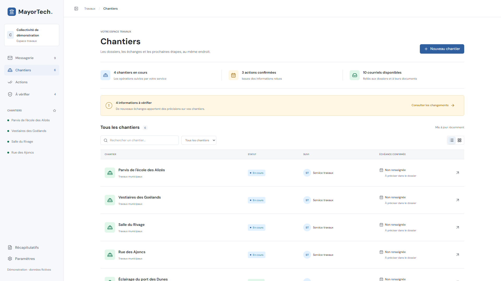
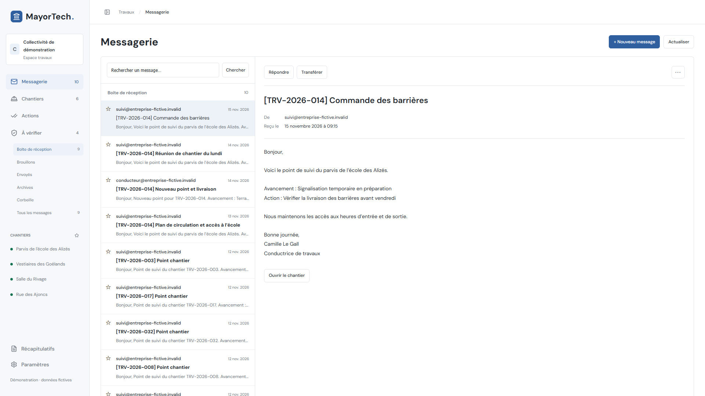
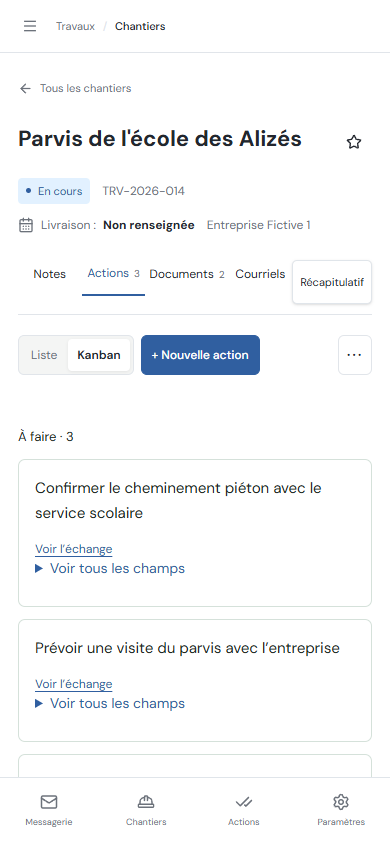

# Frontend Lovable intégré — 15 novembre 2026

L’archive fournie `mayor-project-hub.zip` est devenue la base du client. Ses styles, composants UI, identité MayorTech, navigation, listes, mise en page des dossiers et ressources graphiques sont réemployés dans `frontend-lovable/`. Les données de scénario Supabase ont été remplacées par les API existantes. Les polices sont distribuées localement. [Empreintes de l’archive](../lovable-source.json).

## Parcours vérifiés

- Liste et fiches de chantiers, recherche et filtres ; Notes / Actions / Documents / Courriels.
- Blocs et bases AFFiNE réels, même identifiant de lignes entre liste et Kanban, sauvegarde avant navigation.
- Courriels globaux, dossiers dans la barre gauche, lecture, favoris, classement réversible, réponse/transfert en brouillon.
- Brouillons publics propres au navigateur ; aucune écriture du corps sur le serveur partagé, aucun envoi simulé.
- Pièces originales téléchargeables, propositions et citations exactes, récapitulatifs versionnés conservant leur contexte.
- Six couleurs et deux espacements, profil, membres réels, matrice Casbin et journal ; aucune invitation factice.
- Accès public sans mot de passe ; garde de connexion maintenue pour un espace privé.

La passe de design applique Impeccable (simplification et vérification visuelle), la hiérarchie et le responsive de better-layout, les états/focus de better-accessibility et les contrastes de better-colors. Le choix visuel est celui de l’archive fournie. Les identifiants techniques de recette, faux profils, commandes de blocs redondantes et deuxièmes sélecteurs de vues ont été retirés du parcours quotidien.

## Preuves

Les captures sont de véritables rendus Chromium à **1920 × 1080**, **390 × 844** et **320 × 760**, pas des maquettes générées. Elles ne constituent pas un test sur téléphone physique.

- [Recette locale transversale](local/acceptance.json) : navigation, dernière note sauvegardée, contexte du résumé, originaux, brouillons isolés, couleurs et focus mobile.
- [Recette publique après publication](public/acceptance.json).
- [Tests messagerie et paramètres](../ux-lovable-2026/settings-mail/checks.json).
- [Code libre effectivement repris et licences](../LECTURE_CODE_MAIL_IAM.md) : moteur AFFiNE/BlockSuite, modèle PyCasbin et parseur Nodemailer.

La boîte mairie et le transport d’envoi ne sont pas connectés. La démo contient uniquement des données inventées et un moteur d’analyse déterministe. Le produit n’est pas présenté comme certifié RGPD ou RGAA.
