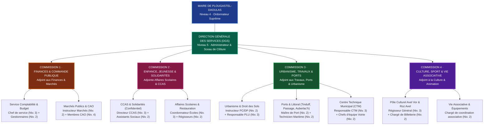
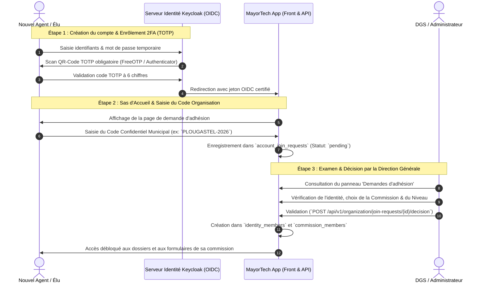

# Guide d'Enrôlement & Matrice des Habilitations Municipales

**Collectivité.** Ville de Plougastel-Daoulas (~13 500 habitants)  
**Plateforme.** MayorTech — Espace Numérique des Commissions & Décisions Municipales  
**Public cible.** Direction Générale des Services (DGS), Direction des Ressources Humaines (DRH), Administrateurs Système et Élus Référents.

---

## 1. Principes Directeurs de l'Enrôlement Municipal

L'enrôlement au sein de MayorTech structure l'ensemble des droits d'accès aux dossiers communaux, aux données citoyennes sensibles (CCAS, quotient familial), aux pièces réglementaires (droit des sols, marchés publics) et aux votes officiels scellés.

### Les 4 Piliers Fondamentaux
1. **Égalité & Séparation des Pouvoirs (Élus vs Services)** :
   - *Les Élus* (Maire, Adjoints, Conseillers) détiennent le pouvoir délibératif, l'arbitrage politique et l'ordonnancement des dépenses.
   - *Les Agents Territoriaux* (DGS, directeurs de pôle, instructeurs, techniciens) détiennent l'expertise technique, préparent les fiches, vérifient la légalité et exécutent les décisions.
2. **Cloisonnement Strict par Commission Permanente** :
   - Un membre actif est rattaché à une ou plusieurs commissions.
   - Les droits sont asymétriques et calculés côté serveur : une même personne peut être éditrice en Culture et simple lectrice en Finances.
   - Aucune fuite d'informations sensibles (dossiers confidentiels CCAS, offres financières sous pli fermé de la CAO) vers les commissions ordinaires.
3. **Double Facteur Obligatoire (MFA / TOTP)** :
   - Aucun mot de passe simple n'est toléré pour accéder aux données municipales.
   - Authentification Keycloak 26.8.2 avec jeton TOTP temporel (FreeOTP, Google Authenticator) et session scellée.
4. **Validation Humaine à Deux Yeux (Zéro Admission Furtive)** :
   - Hors environnement de test fictif, aucune adhésion directe n'est possible sans l'approbation explicite d'un administrateur ou du DGS avec enregistrement de révision.

---

## 2. Matrice des Niveaux de Responsabilité & Rôles Effectifs (RBAC / ABAC)

MayorTech structure les habilitations en **6 niveaux de privilèges** articulés avec les 3 rôles de contenu du noyau (`admin`, `editor`, `reader`) :

| Niveau | Désignation | Rôle Noyau | Exemples de Postes à Plougastel | Capacités & Prérogatives dans MayorTech |
| :---: | :--- | :---: | :--- | :--- |
| **Niv. 0** | **Invité / Démo** | `reader` | Visiteur public, audit externe ponctuel, stagiaire d'observation. | Consultation anonymisée des projets témoins et de la démonstration publique. Aucune écriture, aucun accès aux pièces internes. |
| **Niv. 1** | **Lecteur Sectoriel** | `reader` | Conseiller municipal sans délégation, membre suppléant de commission. | Consultation des dossiers ordinaires de sa commission, lecture de l'agenda et des documents validés. Pas de modification, pas de vote en direct. |
| **Niv. 2** | **Rédacteur / Instructeur Métier** | `editor` | Instructeur Droit des Sols, Gestionnaire Budget, Agent d'état civil, Maître de port. | Création et édition de dossiers, instruction technique (PC/DP), saisie de fiches budgétaires (v1/v2), prise en charge d'actions collaboratives Yjs. |
| **Niv. 3** | **Validateur / Chef de Service** | `editor` | Responsable Urbanisme, Responsable Bâtiments, Responsable Restauration, DRH. | Validation de complétude, ordonnancement interne des tâches de service, préparation de l'ordre du jour des séances, réattribution de tâches de workflow. |
| **Niv. 4** | **Ordonnateur / Élu Délégué** | `admin` | Maire, Adjoints thématiques (Finances, Travaux, Culture, Social), Délégués CAO. | Visa d'arrêtés municipaux, arbitrage financier formel, vote en direct en séance de commission, attribution de marchés publics Mégalis Bretagne. |
| **Niv. 5** | **Administrateur Général / DGS** | `admin` | Directeur Général des Services (DGS), Administrateur Système SI. | Gestion intégrale des habilitations, approbation d'enrôlement, clôture officielle et **scellement cryptographique SHA-256** des procès-verbaux de séance. |

---

## 3. Organigramme de Référence · Mairie de Plougastel-Daoulas



---

## 4. Matrice de Recensement à Compléter (Organigramme & Fichier d'Enrôlement)

Ce tableau est le support contractuel que la mairie (DRH / DGS) complète pour charger la flotte d'utilisateurs. Les lignes d'exemples ci-dessous reprennent l'organigramme effectif de Plougastel :

| Réf / Matricule | Nom & Prénom | Courriel Professionnel (@ville-plougastel.bzh) | Type d'Acteur | Direction / Pôle Municipal | Intitulé Exact du Poste | Commission(s) Rattachée(s) | Niveau Privilège | Rôle Noyau | Délégation Signature | Suppléant / Intérim Désigné |
| :---: | :--- | :--- | :---: | :--- | :--- | :---: | :---: | :---: | :---: | :--- |
| **ELU-001** | CAP Dominique | `maire@ville-plougastel.bzh` | Élu | Exécutif Municipal | Maire de Plougastel-Daoulas | *Toutes (Supervision)* | **Niveau 4** | `admin` | Oui (Arrêté 2026-01) | Adjoint 1 |
| **ELU-002** | LE GALL Jean-Luc | `travaux.elu@ville-plougastel.bzh` | Élu | Exécutif Municipal | Adjoint aux Travaux, Ports & Urbanisme | **Commission 3** (Princ.) + Comm. 1 | **Niveau 4** | `admin` | Oui (Arrêté 2026-03) | Conseiller Délégué |
| **ELU-003** | MORVAN Françoise | `finances.elu@ville-plougastel.bzh` | Élu | Exécutif Municipal | Adjointe aux Finances & Budget | **Commission 1** (Princ.) | **Niveau 4** | `admin` | Oui (Arrêté 2026-02) | Maire |
| **ELU-004** | QUÉRÉ Hélène | `culture.elu@ville-plougastel.bzh` | Élu | Exécutif Municipal | Adjointe à la Culture & Vie Associative | **Commission 4** (Princ.) + Comm. 1 | **Niveau 4** | `admin` | Oui (Arrêté 2026-04) | Conseiller Culture |
| **ELU-005** | BOURHIS Marc | `social.elu@ville-plougastel.bzh` | Élu | Exécutif Municipal | Adjoint aux Solidarités & Enfance | **Commission 2** (Princ.) + Comm. 1 | **Niveau 4** | `admin` | Oui (Arrêté 2026-05) | Directrice CCAS |
| **AGT-001** | DGS Titulaire | `dgs@ville-plougastel.bzh` | Titulaire | Direction Générale | Directeur Général des Services | *Toutes (Administration)* | **Niveau 5** | `admin` | Oui (Par délégation) | DGS Adjoint |
| **AGT-010** | DST Titulaire | `dst@ville-plougastel.bzh` | Titulaire | Services Techniques | Directeur des Services Techniques | **Commission 3** | **Niveau 3** | `editor` | Non | Responsable CTM |
| **AGT-011** | Instructeur ADS | `urbanisme@ville-plougastel.bzh` | Titulaire | Urbanisme & Foncier | Instructeur Droit des Sols | **Commission 3** | **Niveau 2** | `editor` | Non | DST Titulaire |
| **AGT-012** | Maître de Port | `ports.tinduff@ville-plougastel.bzh`| Titulaire | Ports & Littoral | Responsable Ports du Tinduff & Cales | **Commission 3** | **Niveau 2** | `editor` | Non | Agent Portuaire |
| **AGT-020** | Chef Comptable | `comptabilite@ville-plougastel.bzh` | Titulaire | Finances & Commande | Responsable Budget & Dette | **Commission 1** | **Niveau 3** | `editor` | Non | Gestionnaire Dépenses |
| **AGT-021** | Chargé Marchés | `marches@ville-plougastel.bzh` | Contractuel | Finances & Commande | Gestionnaire Commande Publique (CAO) | **Commission 1** | **Niveau 2** | `editor` | Non | Chef Comptable |
| **AGT-030** | Régisseur Avel Vor | `avelvor@ville-plougastel.bzh` | Titulaire | Culture & Animation | Régisseur Général Salle Avel Vor | **Commission 4** | **Niveau 3** | `editor` | Non | Régisseur Adjoint |
| **AGT-031** | Chargé Assos | `associations@ville-plougastel.bzh`| Titulaire | Culture & Animation | Gestionnaire Planning et Matériel | **Commission 4** | **Niveau 2** | `editor` | Non | Régisseur Avel Vor |
| **AGT-040** | Directrice CCAS | `ccas@ville-plougastel.bzh` | Titulaire | Action Sociale | Directrice de l'Action Sociale CCAS | **Commission 2** | **Niveau 3** | `editor` | Non | Assistante Sociale |
| **AGT-041** | Coordo Scolaire | `scolaire@ville-plougastel.bzh` | Titulaire | Enfance & Écoles | Responsable Campagnes Scolaires | **Commission 2** | **Niveau 2** | `editor` | Non | Directrice CCAS |
| *AGT-...* | *À compléter* | *...* | *...* | *...* | *...* | *...* | *...* | *...* | *...* | *...* |

---

## 5. Procédure d'Enrôlement Pas-à-Pas

MayorTech propose 3 méthodes complémentaires pour inscrire et habiliter les personnes.



### Méthode 1 : Enrôlement Massif par Fichier CSV (Recommandé au Démarrage)

Pour initialiser la commune, l'administrateur peut importer le fichier structuré `enrolement_plougastel.csv` via la commande d'exploitation :

```bash
# Vérification du fichier et validation du format sans écriture
python scripts/enrollement_batch.py --file data/enrolement_plougastel.csv --dry-run

# Ingestion réelle avec création idempotente dans Keycloak et MayorTech
python scripts/enrollement_batch.py --file data/enrolement_plougastel.csv --apply
```

**Format standard du CSV attendu** (encodage UTF-8, séparateur virgule) :
```csv
matricule,nom,prenom,email,statut,direction,poste,commission_id,niveau,role,delegation_signature
ELU-002,LE GALL,Jean-Luc,travaux.elu@ville-plougastel.bzh,elu,Travaux,Adjoint aux Travaux,commission-3,4,admin,true
AGT-011,DUPONT,Marie,urbanisme@ville-plougastel.bzh,titulaire,Urbanisme,Instructeur ADS,commission-3,2,editor,false
AGT-020,KERVELLA,Yann,comptabilite@ville-plougastel.bzh,titulaire,Finances,Responsable Budget,commission-1,3,editor,false
```

### Méthode 2 : Auto-Enrôlement avec Code d'Organisation & Approbation DGS

Cette méthode décentralise l'effort d'inscription tout en conservant le contrôle régalien :
1. La DGS communique aux agents et élus le code d'organisation municipal (ex: `PLOUGASTEL-2026`).
2. L'agent accède à [`https://espace.kerforge.com/`](https://espace.kerforge.com/), crée son mot de passe et enrôle son application TOTP.
3. À la première connexion, un formulaire sécurisé lui demande son code municipal.
4. Dès validation du code, la demande apparaît dans le panneau d'administration de la DGS (`Paramètres` > `Demandes d'adhésion`).
5. La DGS assigne en un clic la commission d'appartenance (`Urbanisme`, `Finances`, etc.) et le rôle (`admin`, `editor`, `reader`).

### Méthode 3 : Enrôlement Unitaire Immédiat par l'Administrateur

Depuis le panneau de gestion des accès (`ProjectAccessManager.tsx` et `MemberAccessManager.tsx`) :
1. L'administrateur ouvre l'onglet **Gestion des Membres**.
2. Il clique sur **`+ Ajouter un membre`**, saisit l'adresse professionnelle certifiée.
3. Il sélectionne la commission de rattachement et coche les capacités effectives (`can_edit`, `can_submit_for_review`).
4. L'utilisateur reçoit une invitation immédiate avec lien d'initialisation de son mot de passe et de son TOTP.

---

## 6. Politique de Sécurité, Gestion des Départs & Suppléances

1. **Procédure de Départ / Fin de Mandat (Révocation à Chaud)** :
   - Lorsqu'un agent quitte la collectivité ou qu'un élu termine son mandat, la DGS bascule son statut sur `Inactif` (`active = 0` dans `identity_members`).
   - La session Keycloak est révoquée instantanément via l'API OIDC Backchannel Logout.
   - Les tâches de workflow en cours assignées à cet agent sont automatiquement reversées dans le pool commun de la commission avec notification au chef de service.
2. **Règle de Continuité & Suppléance (Intérim)** :
   - Pour chaque poste à niveau $\ge 3$, un suppléant est obligatoirement renseigné dans la matrice.
   - En cas d'absence déclarée, le système permet la délégation *"On Behalf Of"* : le suppléant peut instruire ou viser les dossiers, chaque action étant scellée avec la mention *"Pour l'Adjoint en titre par M. X (Suppléant désigné)"*.
3. **Traçabilité & Secret Professionnel (RGPD)** :
   - Toutes les créations, approbations, modifications de droits et révocations sont consignées de manière immuable dans `governance_audit_log`.
   - L'accès aux dossiers CCAS et aux délibérations fiscales (CCID) est strictement réservé aux personnes ayant signé la charte de confidentialité municipale.
