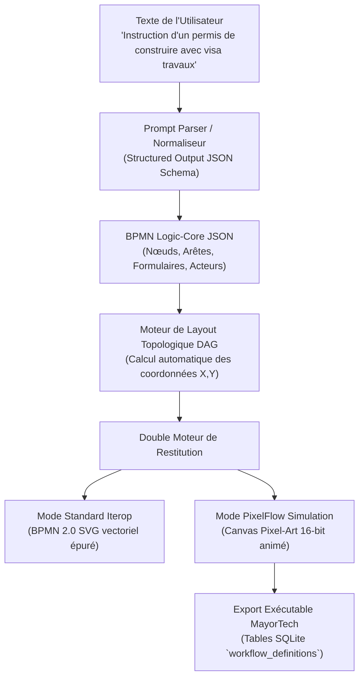

# Spécification Technique & Architecture · Prompt-to-BPMN & Simulateur PixelFlow pour MayorTech

**Date.** 19 novembre 2026  
**Auteur.** Équipe Ingénierie MayorTech / Ville de Plougastel-Daoulas  
**Objet.** Méthode de programmation de workflows BPMN 2.0 (style Iterop) par langage naturel (Prompting), génération automatique du graphe et moteur de simulation visuelle rétro « PixelFlow » pour la vulgarisation des flux de données auprès des élus et agents municipaux.

---

## 1. Vision & Défi d'Adoption

Dans les collectivités locales, les diagrammes BPMN 2.0 industriels (Iterop, Camunda, Signavio) sont souvent perçus comme trop austères ou ésotériques par les élus et les équipes de terrain.

Pour lever ce frein, cette solution combine deux innovations de rupture :
1. **Programmation par Prompting (Natural Language to Workflow)** : Un agent ou un élu décrit simplement son besoin en français (*« Quand une subvention dépasse 5 000 €, exige l'avis préalable de la Commission Finances et le visa de l'Adjoint avant la délibération en séance »*). Le moteur traduit instantanément ce texte en un graphe BPMN 2.0 structuré, avec ses formulaires et ses règles d'affectation.
2. **Simulation Visuelle « PixelFlow » (Data Flow Gamifié)** : Au lieu de simples flèches statiques, le processus prend vie sur un canvas rétro pixel-art (style 16-bit / SimCity municipal). Des petits paquets de données animés (petits facteurs ou conteneurs de pixels lumineux) se déplacent le long des tuyaux, s'arrêtent aux bureaux administratifs, franchissent les portes de décision logiques et remplissent les inventaires de données en direct.

---

## 2. État de l'Art & Réutilisation Open Source (GitHub)

Après analyse des solutions open-source existantes, nous combinons les meilleures approches repérées :

| Répertoire / Projet | Licence | Ce qui est repris et adapté |
|---|---|---|
| **`Stieges/bpmn-generator`** | MIT | Pipeline en 2 étapes : extraction du texte vers un **JSON Logic-Core** structuré, puis calcul de layout topologique automatique sans dépendance complexe. |
| **`jtlicardo/bpmn-assistant`** | Apache-2.0 | Prompting interactif et affinement incrémental (*« Ajoute une étape de notification par SMS »*). |
| **`bpmn-io/bpmn-js-token-simulation`** | MIT | Machine à états de simulation de tokens : propagation le long des arêtes, division en parallèle (AND Fork), synchronisation (AND Join) et choix exclusif (XOR). |
| **`pixel-canvas` / HTML5 Canvas natif** | MIT | Rendu direct canvas 2D avec `image-rendering: pixelated`, système de particules légères et interpolation $t \in [0, 1]$ le long de courbes de Bézier. Zéro moteur lourd (aucun bundle de 50 Mo type Phaser). |

---

## 3. Architecture du Pipeline « Prompt-to-BPMN »



### 3.1 Contrat de Données JSON (BPMN Logic-Core)
L'intelligence artificielle ou le template génère un format strict et compact :

```json
{
  "workflow_key": "instruction_droit_des_sols",
  "title": "Instruction Droit des Sols & Permis de Construire",
  "commission_id": "commission-3",
  "description": "Circuit d'instruction pour les dossiers d'urbanisme de Plougastel",
  "nodes": [
    {
      "id": "start",
      "type": "start_event",
      "label": "Dépôt Dossier",
      "form": {
        "fields": [
          {"id": "ref_cadastrale", "label": "Référence Cadastrale", "type": "text", "required": true},
          {"id": "demandeur", "label": "Identité Demandeur", "type": "text", "required": true},
          {"id": "nature_travaux", "label": "Nature des Travaux", "type": "select", "options": ["Extension", "Piscine", "Clôture", "Maison neuve"]}
        ]
      }
    },
    {
      "id": "task_completude",
      "type": "user_task",
      "label": "Vérification Complétude",
      "role": "instructeur_urbanisme",
      "commission_id": "commission-3",
      "form": {
        "fields": [
          {"id": "pieces_conformes", "label": "Checklist 6 pièces réglementaires", "type": "boolean", "required": true},
          {"id": "impact_littoral", "label": "Impact Loi Littoral ou Portuaire", "type": "boolean", "default": false}
        ]
      }
    },
    {
      "id": "gateway_complet",
      "type": "exclusive_gateway",
      "label": "Dossier Complet ?"
    },
    {
      "id": "task_rejet",
      "type": "user_task",
      "label": "Demande de Pièces Complémentaires",
      "role": "instructeur_urbanisme"
    },
    {
      "id": "task_consultation_ports",
      "type": "user_task",
      "label": "Avis Technique Ports & Ouvrages",
      "role": "responsable_ports",
      "commission_id": "commission-3"
    },
    {
      "id": "task_visa_adjoint",
      "type": "user_task",
      "label": "Visa de l'Adjoint aux Travaux",
      "role": "elu_urbanisme",
      "commission_id": "commission-3"
    },
    {
      "id": "service_notification",
      "type": "service_task",
      "label": "Génération Arrêté & Mail Usager",
      "service_type": "document_and_mail"
    },
    {
      "id": "end_valide",
      "type": "end_event",
      "label": "Permis Délivré"
    }
  ],
  "edges": [
    {"source": "start", "target": "task_completude"},
    {"source": "task_completude", "target": "gateway_complet"},
    {"source": "gateway_complet", "target": "task_consultation_ports", "condition": "pieces_conformes == true && impact_littoral == true", "label": "Complet & Littoral"},
    {"source": "gateway_complet", "target": "task_visa_adjoint", "condition": "pieces_conformes == true && impact_littoral == false", "label": "Complet Standard"},
    {"source": "gateway_complet", "target": "task_rejet", "condition": "pieces_conformes == false", "label": "Incomplet"},
    {"source": "task_rejet", "target": "task_completude", "label": "Pièces reçues"},
    {"source": "task_consultation_ports", "target": "task_visa_adjoint"},
    {"source": "task_visa_adjoint", "target": "service_notification"},
    {"source": "service_notification", "target": "end_valide"}
  ]
}
```

### 3.2 Algorithme d'Auto-Layout Déterministe (DAG Topologique)
Pour positionner les nœuds sans chevauchement :
1. Calcul des niveaux hiérarchiques par tri topologique (largeur d'étape $X$).
2. Répartition verticale $Y$ centrée selon le nombre de branches parallèles.
3. Arêtes orthogonales avec points de coude calculés pour contourner les nœuds existants.

---

## 4. Spécification du Moteur Visuel « PixelFlow »

### 4.1 Direction Artistique Rétro-Chic (16-bit Municipal)
- **Palette de couleurs** :
  - Fond : Sombre bleuté urbain `#0f172a` avec grille de tuiles pixelisées subtiles (`#1e293b`).
  - Nœuds Tâches : Bâtiments municipaux rétro / fiches isométriques pixel-art avec bordure contrastée 2px et ombrage marqué.
  - Passerelles : Cristaux ou losanges dorés rétro clignotants (`#f59e0b`).
  - Conduits de données : Tubes en cuivre ou conduits d'énergie néon pixelisés (`#06b6d4`).
- **Paquets de Données (Data Sprites)** :
  - Représentés sous forme de petites enveloppes ou de petits chariots de pixels animés (`8x8` ou `12x12` pixels).
  - Couleur dynamique selon le contenu : Bleu = Dossier en cours, Vert = Validé avec avis favorable, Rouge = Rejeté/Bloqué.
  - Vitesse de déplacement réglable (`x1`, `x2`, `x5`).
- **Effets Visuels & Gamification** :
  - *Étincelles de pixels* lors du passage dans une passerelle XOR.
  - *Bannière de statut pixel* (ex: `+1 DOSSIER VALIDÉ`) flottante façon jeu rétro.
  - *Inventaire de données* (Popup « Coffre au trésor / Fiche dossier ») affichant les variables accumulées lorsqu'on clique sur un coursier de pixels.

### 4.2 Machine à États de Simulation (Interactive Loop)
Le simulateur dispose d'une barre de contrôle ergonomique :
- **[▶ Lecture / Play]** : Les tokens avancent automatiquement selon les délais paramétrés.
- **[⏸ Pause]** : Fige la simulation pour inspecter l'état exact des données à cet instant.
- **[⏭ Pas-à-Pas / Step]** : Fait avancer le token jusqu'à la prochaine tâche ou décision.
- **[🎲 Scénario Aléatoire / Forcer un Choix]** : Permet à l'utilisateur de simuler soit le cas nominal (*dossier complet*), soit un cas de rejet (*pièces manquantes*) pour voir la boucle de retour s'animer.
- **[↺ Réinitialiser]** : Remet le token au point de départ.

---

## 5. Intégration dans MayorTech

### 5.1 Point d'Accès Frontend
- Nouvel onglet dans la navigation des commissions : **`Workflows & Processus`**.
- Bouton principal : **`✨ Créer un workflow par Prompt`**.
- Modale interactive :
  - Zone de saisie avec suggestions prédéfinies pour Plougastel :
    - *« Instruction d'un permis d'aménager au Port du Tinduff »*
    - *« Demande de subvention culturelle avec arbitrage financier »*
    - *« Déclaration de travaux voirie avec arrêté municipal et publication »*
  - Prévisualisation instantanée :
    - Volet supérieur : Le schéma BPMN classique (mode ingénierie).
    - Volet inférieur : Le canvas **PixelFlow** animé avec les coursiers de données.
  - Bouton **`💾 Déployer dans MayorTech`** : Transforme le schéma simulé en workflow de production exécutable dans la base SQLite locale et sur le serveur Hetzner.

### 5.2 Respect Strict des Invariants
- Le module est totalement isolé dans :
  - Backend : `src/travaux/workflow_iterop.py` et `src/travaux/workflow_prompt.py`.
  - Frontend : `frontend-lovable/src/features/workflow/PixelFlowSimulator.tsx`.
- Aucun des 5 fichiers protégés du noyau (`repository.py`, `workspace.py`, `auth.py`, `jobs.py`, `governance.py`) n'est modifié.

---

## 6. Prochaines Étapes Opérationnelles

1. Implémenter le parseur `workflow_prompt.py` (structure Pydantic + templates municipaux de Plougastel).
2. Construire le composant React Canvas `PixelFlowSimulator.tsx`.
3. Ajouter le bouton de test et de simulation dans l'interface MayorTech.
4. Valider la simulation Playwright avec captures Full HD et mobiles.
