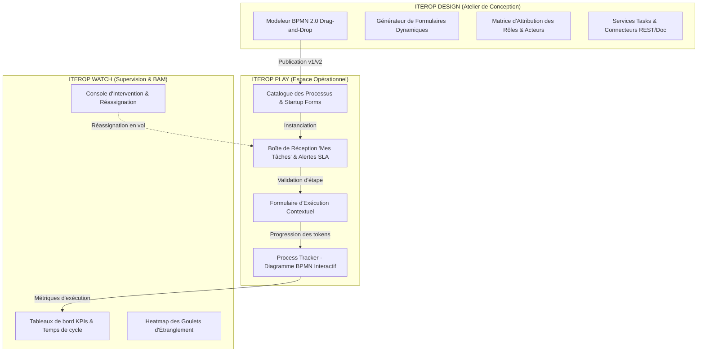
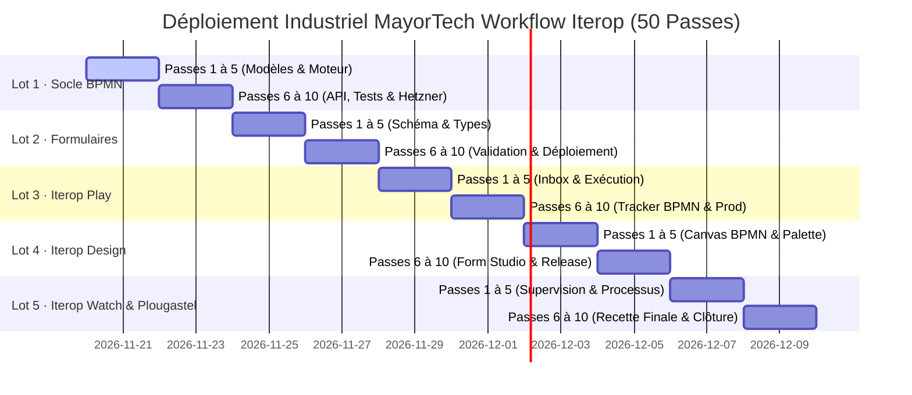

# Plan Directeur d'Ingénierie · Moteur de Workflow BPMN 2.0 & Suite Open-Source « MayorFlow » (Alternative 100% Libre à Iterop)

**Date.** 19 novembre 2026  
**Cible.** Ville de Plougastel-Daoulas & Déploiement SaaS MayorTech  
**Licence & Coût.** **100% Logiciel Libre & Open-Source · 0 € de redevance (Zéro licence propriétaire)**  
**Objectif.** Concevoir et implémenter une suite complète de Business Process Management (BPM) low-code souveraine, intitulée **MayorFlow**, offrant toutes les fonctionnalités ergonomiques d'**Iterop (Dassault Systèmes / Visiativ)** sans aucun coût de licence commerciale :
- Moteur d'exécution BPMN 2.0 en Python natif basé sur **SpiffWorkflow** (LGPL/BSD) et `TokenEngine` FastAPI.
- Modeleur graphique drag-and-drop basé sur le standard mondial **`bpmn-js` (MIT)**.
- Formulaires dynamiques ouverts basés sur **React JSON Schema Form** (Apache 2.0).
- Suite opérationnelle intégrée : **MayorFlow Play** (inbox collaborative), **MayorFlow Studio** (atelier de modélisation visuel) et **MayorFlow Watch** (supervision BAM et heatmaps).

---

## 1. Contexte Stratégique : Pourquoi une Alternative Open-Source à Iterop ?

Dans une collectivité comme la Mairie de Plougastel-Daoulas, le traitement des dossiers transverses (urbanisme, finances, culture, jeunesse, travaux) souffre traditionnellement de silos administratifs, d'échanges d'e-mails informels et de feuilles de calcul disparates.

La suite commerciale **Iterop (Visiativ / Dassault Systèmes)** propose un modèle ergonomique pertinent mais est un **logiciel fermé, propriétaire et payant** (tarifs de 10 à 30 €/utilisateur/mois + coûts d'intégration substantiels).

Pour préserver la souveraineté financière et technique des communes, MayorTech implémente **MayorFlow**, une suite BPMN 2.0 strictement équivalente sur le plan fonctionnel, mais **100% libre et auto-hébergée (0 € de licence)** s'articulant en 3 espaces :
1. **MayorFlow Play** : L'espace quotidien des agents et élus pour exécuter leurs tâches ("Mes tâches"), renseigner des formulaires guidés et suivre graphiquement l'avancement des démarches.
2. **MayorFlow Studio** : L'atelier de conception visuelle propulsé par `bpmn-js` (MIT) permettant aux directeurs de pôles et administrateurs de modéliser des processus BPMN 2.0 par glisser-déposer, de générer des formulaires et de paramétrer des règles d'automatisation sans coder.
3. **MayorFlow Watch** : Le tableau de bord d'analyse de la performance (BAM), traquant les délais réglementaires (ex: 2 mois pour un permis de construire), les goulets d'étranglement et permettant la réattribution d'urgence.

L'intégration de cette suite dans MayorTech décuple l'efficacité des 4 commissions permanentes livrées précédemment.

---

## 2. Reverse-Engineering & Spécifications des 3 Modules Iterop



### 2.1 Iterop Design (Business Process Designer)
- **Palette BPMN 2.0 complète** :
  - *Événements de début* : Manuel (clic agent), Message (Webhook API entrant), Minuteur (lancement programmé).
  - *Tâches humaines (User Tasks)* : Associées à un formulaire dynamique et à une cible d'affectation.
  - *Tâches automatisées (Service Tasks)* : Exécution de webhooks HTTP REST, génération de documents PDF/DOCX certifiés, envoi de courriels d'alerte, scripts de calcul.
  - *Passerelles de décision (Gateways)* :
    - **XOR (Exclusive)** : Branchement conditionnel unique (ex: si `montant > 5000 €`).
    - **AND (Parallel)** : Déclenchement simultané de branches parallèles et synchronisation (*Fork & Join*).
    - **OR (Inclusive)** : Déclenchement de 1 à N branches selon prédicats.
  - *Événements intermédiaires* : Minuteur (relance automatique après délai X), Message (attente d'accusé de réception externe).
  - *Événements de fin* : Fin normale de processus, Fin avec résiliation/annulation.
- **Form Builder Low-Code (Générateur de formulaires)** :
  - Support de 10 types de contrôles : `text`, `textarea`, `number`, `currency_cents`, `date`, `select`, `multiselect`, `boolean`, `file_upload`, `data_table` (lignes dynamiques).
  - Propriétés de champ : Variable ID, Libellé, Description/Placeholder, Obligatoire (`required`), Mode d'accès (`editable`, `readonly`, `hidden`), Valeur par défaut.
  - Règles de visibilité conditionnelle : expression logique (ex: `visible_if: avis == 'defavorable'`).
- **Gestionnaire d'attribution des acteurs** :
  - *Attribution statique* : Utilisateur spécifique ou rôle organisationnel (`admin`, `editor`, `reader`).
  - *Attribution dynamique* : Commission rattachée (`commission-1` à `commission-4`) ou variable du processus (ex: `{{rapporteur}}`, `{{instructeur}}`).
  - *Pool de candidats & Prise en charge ("Claim")* : Tâche visible par tous les membres d'une commission, avec bouton *"S'attribuer la tâche"*.

### 2.2 Iterop Play (Business Process Player)
- **Boîte de réception unifiée ("Mes Tâches")** :
  - Liste ergonomique des tâches à réaliser, filtrables par commission, urgence et processus.
  - Badges d'alerte SLA : `Dans les délais` (vert), `Échéance proche` (orange), `En retard` (rouge clignotant).
  - Mode double panneau : Liste des tâches à gauche, fiche de réalisation à droite.
- **Formulaire d'exécution contextuel** :
  - Rendu haute fidélité du formulaire paramétré dans Design.
  - Rappel en lecture seule des données saisies aux étapes précédentes (vue d'ensemble sans rupture).
  - Téléchargement et prévisualisation directe des pièces jointes.
  - Boutons de transition configurés (ex: `[Valider l'avis]`, `[Demander un complément]`, `[Rejeter]`).
- **Process Tracker (Suivi graphique en direct)** :
  - Diagramme BPMN vectoriel interactif matérialisant l'état d'exécution :
    - Vert émeraude : Étapes franchies, horodatées avec nom de l'agent.
    - Bleu vif pulsant : Étape active en cours de traitement.
    - Gris clair : Étapes prévisionnelles à venir.
    - Rouge : Étape interrompue ou refusée.
  - Journal d'audit complet (*Audit Trail*) avec historique des valeurs de variables et commentaires.
- **Catalogue de démarrage** :
  - Grille de cartes représentant les processus publiables, avec icônes métier et formulaire de démarrage (*Startup Form*).

### 2.3 Iterop Watch (Business Activity Monitoring)
- **Tableau de bord de pilotage** :
  - Compteurs d'instances actives, terminées, et taux de respect des délais légaux.
  - Temps de cycle moyen (global et étape par étape).
  - Détecteur de goulets d'étranglement (*Bottleneck Detection*) mettant en exergue les étapes qui retardent les dossiers.
- **Console d'administration** :
  - Réassignation d'une tâche bloquée (ex: agent en congé).
  - Correction de variable en vol pour débloquer une passerelle logique erronée.
  - Relance d'une *Service Task* en échec (ex: timeout API tiers).

---

## 3. Architecture Technique & Intégration dans MayorTech

### 3.1 Préservation Absolue des Invariants du Noyau
Conformément aux règles architecturales de MayorTech, les 5 fichiers protégés du noyau restent **100 % intangibles** avec vérification des empreintes SHA-256 :
- `src/travaux/repository.py` : `AF7C56E2`
- `src/travaux/workspace.py` : `D5717BA8`
- `src/travaux/auth.py` : `4123A8BF`
- `src/travaux/jobs.py` : `7F7F46DF`
- `src/travaux/governance.py` : `9E5A5160`

### 3.2 Modèle de Données SQLite (`src/travaux/workflow_iterop.py`)
Toutes les tables sont créées avec `PRAGMA foreign_keys=ON` et cloisonnées par `tenant_id` :

```sql
-- 1. Définitions de processus
CREATE TABLE IF NOT EXISTS workflow_definitions (
    tenant_id TEXT NOT NULL,
    definition_id TEXT NOT NULL,
    commission_id TEXT NOT NULL,
    key TEXT NOT NULL,
    title TEXT NOT NULL,
    description TEXT,
    icon TEXT DEFAULT 'GitBranch',
    category TEXT NOT NULL, -- 'urbanisme', 'culture', 'social', 'finances', 'general'
    created_at TEXT NOT NULL,
    created_by TEXT NOT NULL,
    PRIMARY KEY (tenant_id, definition_id)
);

-- 2. Versions publiées ou brouillons (BPMN JSON + Forms JSON)
CREATE TABLE IF NOT EXISTS workflow_versions (
    tenant_id TEXT NOT NULL,
    version_id TEXT NOT NULL,
    definition_id TEXT NOT NULL,
    version_number INTEGER NOT NULL,
    status TEXT NOT NULL CHECK(status IN ('draft', 'published', 'archived')),
    bpmn_graph_json TEXT NOT NULL, -- Graphe: nodes (events, tasks, gateways) et edges
    startup_form_json TEXT NOT NULL, -- Schéma de formulaire d'initiation
    forms_json TEXT NOT NULL, -- Dictionnaire task_key -> form_schema
    published_at TEXT,
    published_by TEXT,
    PRIMARY KEY (tenant_id, version_id),
    FOREIGN KEY (tenant_id, definition_id) REFERENCES workflow_definitions(tenant_id, definition_id) ON DELETE CASCADE
);

-- 3. Instances de processus en cours d'exécution
CREATE TABLE IF NOT EXISTS workflow_instances (
    tenant_id TEXT NOT NULL,
    instance_id TEXT NOT NULL,
    definition_id TEXT NOT NULL,
    version_id TEXT NOT NULL,
    project_id TEXT, -- Dossier communal MayorTech éventuellement rattaché
    title TEXT NOT NULL,
    status TEXT NOT NULL CHECK(status IN ('running', 'completed', 'suspended', 'cancelled')),
    initiated_by TEXT NOT NULL,
    initiated_at TEXT NOT NULL,
    completed_at TEXT,
    current_tokens_json TEXT NOT NULL, -- Liste des nœuds BPMN actifs
    sla_deadline TEXT,
    PRIMARY KEY (tenant_id, instance_id),
    FOREIGN KEY (tenant_id, version_id) REFERENCES workflow_versions(tenant_id, version_id)
);

-- 4. Tâches humaines instanciées (Iterop Play)
CREATE TABLE IF NOT EXISTS workflow_tasks (
    tenant_id TEXT NOT NULL,
    task_id TEXT NOT NULL,
    instance_id TEXT NOT NULL,
    node_key TEXT NOT NULL,
    title TEXT NOT NULL,
    task_type TEXT NOT NULL CHECK(task_type IN ('user_task', 'service_task')),
    assignee_type TEXT NOT NULL CHECK(assignee_type IN ('user', 'role', 'commission', 'pool')),
    assigned_to TEXT NOT NULL,
    claimed_by TEXT,
    status TEXT NOT NULL CHECK(status IN ('pending', 'completed', 'cancelled')),
    priority TEXT NOT NULL DEFAULT 'normal' CHECK(priority IN ('low', 'normal', 'high', 'urgent')),
    form_schema_json TEXT NOT NULL,
    submitted_data_json TEXT,
    due_date TEXT,
    created_at TEXT NOT NULL,
    completed_at TEXT,
    completed_by TEXT,
    PRIMARY KEY (tenant_id, task_id),
    FOREIGN KEY (tenant_id, instance_id) REFERENCES workflow_instances(tenant_id, instance_id) ON DELETE CASCADE
);

-- 5. Variables d'instance de processus
CREATE TABLE IF NOT EXISTS workflow_variables (
    tenant_id TEXT NOT NULL,
    instance_id TEXT NOT NULL,
    var_key TEXT NOT NULL,
    var_type TEXT NOT NULL CHECK(var_type IN ('string', 'number', 'boolean', 'json', 'file_ref')),
    var_value TEXT,
    updated_at TEXT NOT NULL,
    updated_by TEXT NOT NULL,
    PRIMARY KEY (tenant_id, instance_id, var_key),
    FOREIGN KEY (tenant_id, instance_id) REFERENCES workflow_instances(tenant_id, instance_id) ON DELETE CASCADE
);

-- 6. Journal d'audit et historique complet
CREATE TABLE IF NOT EXISTS workflow_audit_log (
    tenant_id TEXT NOT NULL,
    log_id TEXT NOT NULL,
    instance_id TEXT NOT NULL,
    task_id TEXT,
    node_key TEXT,
    action TEXT NOT NULL, -- 'start_instance', 'complete_task', 'claim_task', 'evaluate_gateway', 'execute_service'
    actor_id TEXT NOT NULL,
    timestamp TEXT NOT NULL,
    details_json TEXT NOT NULL,
    PRIMARY KEY (tenant_id, log_id)
);
```

### 3.3 Moteur d'Exécution BPMN 2.0 (Micro-Engine Python Déterministe)
- Le moteur réside dans `src/travaux/workflow_iterop.py` et ne dépend d'aucun runtime lourd Java.
- **Machine à tokens** : Une instance de processus gère un tableau de tokens d'activité actifs `[node_key, ...]`.
- **Exécution d'une transition** :
  1. Lorsqu'une tâche humaine est soumise avec succès (données validées), son token est consommé.
  2. Les variables soumises sont stockées dans `workflow_variables`.
  3. Le moteur recherche les arcs sortants (*sequence flows*).
  4. Pour une passerelle **XOR**, il évalue les conditions sur les variables et active la branche valide.
  5. Pour une passerelle **AND (Fork)**, il produit un token pour chaque branche sortante.
  6. Pour une passerelle **AND (Join)**, il attend la convergence de tous les tokens avant d'avancer.
  7. Pour une **Service Task**, il exécute la fonction associée (webhook, notification, génération d'acte) de manière synchrone ou en tâche de fond, puis passe automatiquement au nœud suivant.
  8. Lorsque le token atteint un nœud **End Event**, l'instance passe en `completed`.

---

## 4. Feuille de Route en 5 Lots Industriels (50 Passes de Rétroaction)

Chaque lot est soumis au standard ultra-exigeant de **10 passes de rétroaction / self-critique**, validé par tests unitaires, vérification TypeScript, packaging Vite, et recette visuelle Playwright (Full HD 1920×1080, Mobile 390×844, Compact 320×568) locale et en production Hetzner.



---

### Lot 1 · Socle de Données, Définitions BPMN & Moteur d'Exécution Minimal

- **Passe 1 (Schéma de persistance SQLite)** : Création des tables `workflow_definitions`, `workflow_versions`, `workflow_instances`, `workflow_tasks`, `workflow_variables`, `workflow_audit_log` dans `workflow_iterop.py` avec `PRAGMA foreign_keys=ON`.
- **Passe 2 (Moteur d'exécution & Token Machine)** : Implémentation de `WorkflowEngine.start_instance()` et `WorkflowEngine.complete_task()` avec gestion des tokens actifs et journalisation d'audit.
- **Passe 3 (Passerelles logiques XOR & AND)** : Évaluateur d'expressions conditionnelles Python sécurisé (`eval_expression` sans builtins) pour les routes alternatives et synchronisation des forks/joins.
- **Passe 4 (Tâches de service automatisées)** : Connecteur webhook HTTP REST avec injection de variables `{{variable}}`, gestion des timeouts et codes de statut HTTP.
- **Passe 5 (Couche API REST FastAPI)** : Exposition des endpoints `/api/v1/workflows/definitions`, `/api/v1/workflows/instances`, `/api/v1/workflows/instances/{id}/start`, `/api/v1/workflows/tasks/{id}/complete`. Déclaration dans `request_permission`.
- **Passe 6 (Client JS & Types TypeScript)** : Typage complet dans `frontend-lovable/src/features/workflow/types.ts` et méthodes clientes dans `web/api.js`.
- **Passe 7 (Intégration Shell & Navigation)** : Ajout de l'entrée `'Workflows & Processus'` dans la navigation globale de MayorTech, filtrée selon la commission active.
- **Passe 8 (Suites de tests automatisés exhaustives)** : 8 tests unitaires Python dans `tests/test_workflow_engine.py` + tests API dans `tests/test_workflow_api.py`. Typecheck TypeScript à 0 erreur.
- **Passe 9 (Recette visuelle locale Playwright)** : Script `tests/browser/lot1_workflow_proof.py` générant 7 captures (Full HD, 390px, 320px) avec manifeste d'intégrité SHA-256.
- **Passe 10 (Release & Déploiement Hetzner)** : Packaging `package_frontend.py`, gate signée, déploiement sur `https://travaux.kerforge.com` et mise à jour de l'espace privé `https://espace.kerforge.com`.

---

### Lot 2 · Formulaires Dynamiques, Validation JSONSchema & Variables de Processus

- **Passe 1 (Spécification du schéma de formulaires)** : Modèle JSON déclaratif pour les 10 types de contrôles (`text`, `textarea`, `number`, `currency_cents`, `date`, `select`, `multiselect`, `boolean`, `file_upload`, `data_table`).
- **Passe 2 (Moteur de validation Pydantic / JSONSchema côté serveur)** : Validation stricte des données soumises avant tout passage à l'étape suivante, rejet des champs obligatoires manquants ou types invalides.
- **Passe 3 (Règles de visibilité et d'accessibilité)** : Évaluation des prédicats `visible_if` et `editable_if` en fonction de l'état actuel des variables d'instance.
- **Passe 4 (Gestionnaire de pièces jointes)** : Intégration transparente avec `DocumentRepository` de MayorTech pour le téléversement et le scellement de pièces jointes dans le formulaire.
- **Passe 5 (Tableaux dynamiques de saisie)** : Prise en charge des lignes répétables (ex: décomposition budgétaire d'une manifestation culturelle ou liste de parcelles cadastrales).
- **Passe 6 (Composant de rendu dynamique React)** : Création de `frontend-lovable/src/features/workflow/DynamicFormRenderer.tsx` et styles ergonomiques `workflow-forms.css`.
- **Passe 7 (Gestion des erreurs de saisie en direct)** : Affichage d'alertes visuelles contextualisées sous les champs non valides sans perte de saisie.
- **Passe 8 (Suites de tests automatisés)** : Tests de validation des formats (dates, devises en centimes, booléens) et tests d'injection.
- **Passe 9 (Recette visuelle locale Playwright)** : 7 captures validant les différents types de champs et les règles de visibilité dynamique.
- **Passe 10 (Déploiement en Production Hetzner)** : Release packagée, migrations vérifiées et validation en direct sur le VPS de production.

---

### Lot 3 · Iterop Play · Boîte de Réception "Mes Tâches", Formulaires d'Exécution & Catalogue

- **Passe 1 (API de Boîte de Réception filtrée)** : Endpoint `/api/v1/workflows/tasks/inbox` avec filtres par statut, urgence, commission et assignation (assignée à moi vs disponible dans mon pool).
- **Passe 2 (Mécanisme de Prise en Charge "Claim / Release")** : Possibilité pour un agent d'attribuer une tâche commune à son nom (`claim`), ou de la relâcher (`release`) vers le groupe.
- **Passe 3 (Calcul des Délais & Alertes SLA)** : Calcul automatique du temps restant avant échéance réglementaire, attribution de badges visuels (`URGENT`, `ÉCHÉANCE AUJOURD'HUI`, `EN RETARD`).
- **Passe 4 (Interface Boîte de Réception `TaskInbox.tsx`)** : Vue moderne double panneau (liste des tâches à gauche avec filtres et compteurs, zone de travail à droite) avec typographie DM Sans.
- **Passe 5 (Modale d'Exécution de Tâche `TaskExecutionModal.tsx`)** : Formulaire dynamique intégré, rappel des données précédentes en lecture seule, boutons d'action métier (`[Valider]`, `[Refuser]`, `[Demander complément]`).
- **Passe 6 (Process Tracker BPMN Dynamique `ProcessTracker.tsx`)** : Composant SVG/Canvas interactif affichant le diagramme du processus avec surlignage émeraude des étapes franchies et bleu pulsant de l'étape active.
- **Passe 7 (Catalogue des Processus & Startup Forms)** : Grille de sélection des processus disponibles pour l'agent, avec dialogue de démarrage et saisie du formulaire initial.
- **Passe 8 (Suites de tests de régression & Performance)** : Tests de charge sur l'inbox, non-régression de l'accès par rôle et commission.
- **Passe 9 (Recette visuelle locale Playwright)** : 7 captures (inbox avec tâches multiples, exécution de formulaire, visualisation du Process Tracker, vue responsive 390px et 320px).
- **Passe 10 (Déploiement en Production Hetzner)** : Déploiement sans interruption, 7 captures capturées sur `https://travaux.kerforge.com` et base ensemencée.

---

### Lot 4 · Iterop Design · Studio de Conception BPMN Visuel & Assignation des Rôles

- **Passe 1 (Spécification du graphe BPMN JSON)** : Structure canonique des nœuds (`id`, `type`, `label`, `x`, `y`, `config`) et des arêtes (`id`, `source`, `target`, `condition`).
- **Passe 2 (Composant Canvas Vectoriel `WorkflowDesigner.tsx`)** : Studio visuel avec grille aimantée, glisser-déposer de nœuds depuis la boîte à outils latérale, et tracé de flèches orientées.
- **Passe 3 (Boîte à outils BPMN complète)** : Événements (Start, End, Timer), Tâches (Humaine, Service REST, Notification), Passerelles (XOR, AND).
- **Passe 4 (Éditeur de Formulaires Drag-and-Drop `DynamicFormBuilder.tsx`)** : Interface visuelle pour composer le formulaire d'une tâche humaine en glissant des champs typés depuis une palette latérale.
- **Passe 5 (Panneau de Propriétés des Nœuds)** : Configuration latérale : libellé, description, affectation d'acteurs (rôle, commission, pool, variable dynamique), conditions sur les branches de sortie.
- **Passe 6 (Contrôles de Validité & Linting BPMN)** : Vérification en temps réel de la complétude du graphe (nœud de départ unique, pas de nœud isolé sans lien, boucle infinie sans condition, fin présente).
- **Passe 7 (Gestionnaire de Versions & Publication)** : Gestion des états `Brouillon` et `Publié` (v1, v2) avec immutabilité des versions en cours d'exécution.
- **Passe 8 (Tests automatisés du Studio)** : Tests unitaires de sérialisation/désérialisation BPMN JSON, validation des graphes cycliques et acycliques.
- **Passe 9 (Recette visuelle locale Playwright)** : 7 captures de l'atelier de modélisation (palette d'outils, canvas avec processus complexe, constructeur de formulaire, configuration des rôles).
- **Passe 10 (Déploiement en Production Hetzner)** : Release packagée, mise en ligne sur le VPS et vérification des permissions créateur de workflow.

---

### Lot 5 · Iterop Watch · Pilotage BAM, Supervisions & Processus Types de Plougastel

- **Passe 1 (Moteur d'Agrégation des Métriques BPM)** : Calcul des temps de passage par étape, taux de complétion, respect des délais réglementaires et identification des goulots d'étranglement.
- **Passe 2 (Console de Supervision `ProcessWatch.tsx`)** : Tableaux de bord de Business Activity Monitoring (BAM) avec indicateurs synthétiques, histogrammes et diagrammes de flux.
- **Passe 3 (Outils d'Intervention d'Urgence)** : Actions administrateur : réattribution d'une tâche bloquée, modification d'une variable en vol, relance d'une *Service Task* en erreur, annulation d'instance.
- **Passe 4 (Processus Type 1 · Instruction Droit des Sols - Urbanisme)** :
  - *Modèle complet* : Dépôt dossier PC/DP -> Vérification complétude (checklist) -> Consultation services (Voirie/Ports) -> Visa Adjoint -> Notification arrêté.
- **Passe 5 (Processus Type 2 · Arbitrage Financier de Manifestation - Culture → Finances)** :
  - *Modèle complet* : Déclaration fête associative -> Contrôle anti-conflit créneau salle -> Fiche chiffrée (Variantes A/B) -> Transmission Finances -> Avis motivé -> Délibération officielle.
- **Passe 6 (Processus Type 3 · Attribution de Marché Public - CAO / Mégalis)** :
  - *Modèle complet* : Publication consultation Mégalis -> Dépôt des plis -> Analyse technique & financière -> Convocation CAO (Quorum) -> Séance & votes scellés SHA-256 -> Notification attributaire.
- **Passe 7 (Export et Journalisation d'Actes Légaux)** : Génération automatique d'un procès-verbal d'exécution du workflow avec empreinte cryptographique SHA-256.
- **Passe 8 (Suites de tests de bout en bout exhaustives)** : Exécution automatisée des 3 processus types de Plougastel avec toutes leurs variantes et branches alternatives.
- **Passe 9 (Recette visuelle Playwright complète)** : 7 captures de production validant le cockpit Watch, la heatmap des goulets et l'exécution complète d'un processus municipal.
- **Passe 10 (Attestation Finale de Release & Recette en Production Hetzner)** : Déploiement de la release finale, vérification HTTPS sur `https://travaux.kerforge.com` et `https://espace.kerforge.com`, archivage des 70 captures globales.

---

## 5. Synthèse des Écrans et Preuves de Recherche

Les captures d'écran des fonctionnalités de référence d'Iterop ont été consignées dans `docs/superpowers/plans/iterop-research/` :
- `dps_iterop_top.png` : Exemple réel de processus BPMN complet (Start, User Tasks, Service Tasks Google Drive, Gateways XOR, Minuteurs de relance 15j / 33j).
- `youtube_iterop_search.png` : Analyse comparative des modules *Play* (exécution des tâches), *Watch* (indicateurs BAM) et *Design* (modeleur visuel BPMN).

Ce document constitue la feuille de route contractuelle pour lancer le développement immédiat du **Lot 1**.
